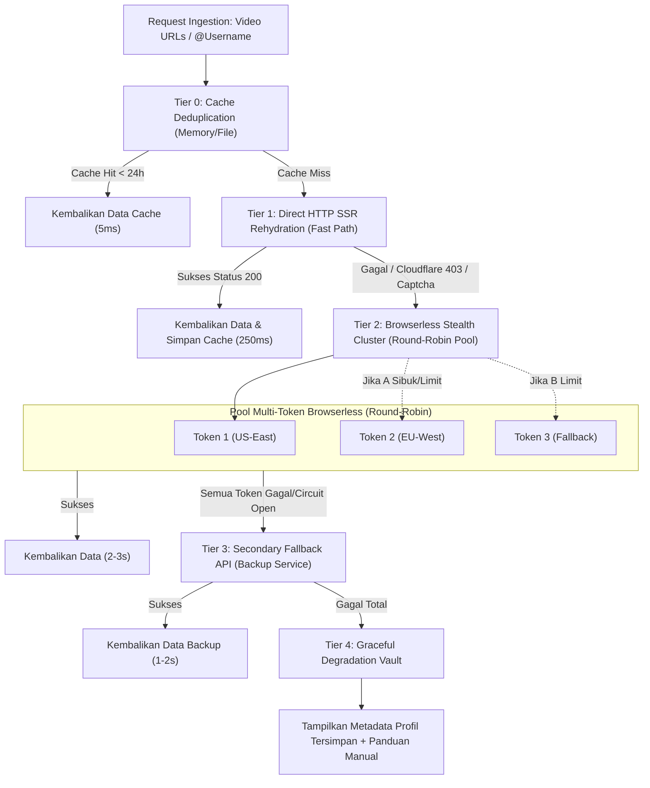

# PRD & Arsitektur Teknis: Multi-Provider API Fallback & Round-Robin Engine
**Produk**: Sorot by Secommercs  
**Versi Dokumen**: 1.0.0 (Draft Arsitektur)  
**Status**: Ready for Review / Decision  
**Target Penulis**: Product Manager & Lead Systems Architect  

---

## 1. Executive Summary & Problem Statement

### Masalah Saat Ini (*Single Point of Failure*)
Saat ini, mesin *scraping* dan analitik Sorot bergantung pada **1 token Browserless.io tunggal** yang memproses seluruh permintaan ekstraksi data (baik video tunggal, batch URL, maupun profil kreator):
1. **Risiko Concurrency & Rate Limit**: Jika ada banyak pengguna atau batch 10 video sekaligus, batas konkurensi (misal: 5 worker paralel) dapat terlampaui sehingga terjadi antrean panjang (*timeout*).
2. **Ketergantungan Tunggal (SPOF)**: Jika token Browserless kehabisan kuota atau IP region tertentu dibatasi sementara oleh TikTok (HTTP 429 / 403), seluruh aplikasi Sorot mengalami *downtime*.
3. **Biaya & Latensi Browser**: Menjalankan browser headless penuh (*Chromium*) membutuhkan waktu 3–4 detik per video. Sebagian besar data TikTok sebenarnya dapat ditarik dalam 200–400 milidetik melalui *Direct SSR Rehydration* tanpa perlu merender DOM penuh.

### Sasaran Solusi (*Objective*)
Membangun **Multi-Provider Resilient Ingestion Engine** yang menggabungkan:
* **Round-Robin Load Balancing**: Membagi beban scraping secara merata ke beberapa token/worker Browserless.
* **Tiered Fallback Hierarchy**: Jalur cepat (*Fast Path*) HTTP Rehydration $\rightarrow$ Pool Browserless Stealth $\rightarrow$ Secondary External API.
* **Circuit Breaker Pattern**: Otomatis mengisolasi penyedia API yang sedang *down* atau terkena limit tanpa mengganggu pengguna.
* **Target SLA**: 99.9% tingkat keberhasilan scraping dengan penurunan latensi rata-rata hingga 60%.

---

## 2. Diagram Alur Arsitektur (*Tiered Routing Strategy*)



---

## 3. Spesifikasi Tingkatan Penyedia (*Tier Specification*)

| Tingkat | Nama Provider | Mekanisme | Estimasi Latensi | Biaya per Req | Kapan Digunakan |
| :--- | :--- | :--- | :--- | :--- | :--- |
| **Tier 0** | **Memory/Local Cache** | Cache hash ID video di memori/storage dengan TTL 24 jam. | ~5 ms | \$0.00 | Permintaan ulang video atau profil yang sama. |
| **Tier 1** | **Direct SSR Rehydration** | Node `fetch` langsung ke URL TikTok dengan *User-Agent mobile* & header *spoofed*. Langsung mem-parsing `__UNIVERSAL_DATA_FOR_REHYDRATION__`. | 200–400 ms | \$0.00 (Nol browser credit) | **Jalur Utama Otomatis (Default Fast-Path)** untuk semua single video. |
| **Tier 2** | **Browserless Cluster** | Pool multi-token Browserless dengan parameter `stealth=true` dan rotasi *Round-Robin*. | 2.5–3.5 s | Menggunakan kuota Browserless | Digunakan jika Tier 1 terhalang bot protection, atau untuk scraping profil akun. |
| **Tier 3** | **Secondary External API** | Panggilan API ke cadangan pihak ketiga (RapidAPI / ScrapeCreators / Webhook proxy). | 1.0–2.0 s | Sesuai tarif API cadangan | Aktif otomatis jika seluruh token Tier 2 mengalami *circuit breaker trip*. |
| **Tier 4** | **Degradation Vault** | Mengembalikan profil yang ada di arsip lokal atau menampilkan kartu profil dengan status edukasi. | ~10 ms | \$0.00 | Upaya terakhir agar UI tidak pernah blank/crash. |

---

## 4. Mekanisme Algoritma Round-Robin & Circuit Breaker

### A. Algoritma Weighted Round-Robin
```javascript
class ProviderPool {
  constructor(providers) {
    this.providers = providers; // [{ id, endpoint, token, weight, activeReqs, failures }]
    this.currentIndex = 0;
  }

  getNextProvider() {
    const healthy = this.providers.filter(p => !p.circuitOpen);
    if (healthy.length === 0) throw new Error("Semua penyedia scraping sedang mengalami gangguan.");

    // Pilih penyedia berdasarkan round-robin dengan beban paling rendah
    const selected = healthy[this.currentIndex % healthy.length];
    this.currentIndex = (this.currentIndex + 1) % healthy.length;
    return selected;
  }
}
```

### B. Status Circuit Breaker (Pencegahan Kegagalan Berantai)
Setiap penyedia memiliki 3 status operasional:
1. **`CLOSED` (Normal)**:
   * Semua panggilan diarahkan secara normal.
   * Tingkat kegagalan dipantau.
2. **`OPEN` (Terputus / Isolasi)**:
   * Jika penyedia mengalami **3 kegagalan berturut-turut** (HTTP 429 Too Many Requests, 403 Forbidden, atau Timeout > 15 detik), status berubah ke `OPEN`.
   * Penyedia diistirahatkan selama **60 detik** (*cooldown*). Tidak ada *request* baru yang dikirim ke node ini; lalu lintas langsung dialihkan ke node berikutnya di pool.
3. **`HALF-OPEN` (Uji Coba Pemulihan)**:
   * Setelah masa *cooldown* 60 detik usai, 1 permintaan percobaan (*canary request*) dikirim.
   * Jika sukses, status kembali ke `CLOSED` (Sehat). Jika masih gagal, masa isolasi diperpanjang 120 detik.

---

## 5. Konfigurasi Variabel Lingkungan (`.env`)

Sistem didesain modular melalui konfigurasi `.env` tanpa perlu mengubah kode sumber jika ingin menambah token atau penyedia baru:

```ini
# --- TIER 1: DIRECT SSR CONFIG ---
ENABLE_DIRECT_SSR_FASTPATH=true
DIRECT_SSR_TIMEOUT_MS=8000

# --- TIER 2: BROWSERLESS MULTI-TOKEN POOL ---
# Format: token1,token2,token3 (Otomatis diputar via Round-Robin)
BROWSERLESS_TOKENS=your_primary_token,your_secondary_token,your_backup_token
BROWSERLESS_BASE_URL=wss://chrome.browserless.io
BROWSERLESS_CONCURRENCY_PER_TOKEN=3
BROWSERLESS_TIMEOUT_MS=35000

# --- TIER 3: SECONDARY BACKUP API (OPSIONAL) ---
ENABLE_SECONDARY_FALLBACK=false
SECONDARY_API_URL=https://api.example-scraper.com/v1/tiktok
SECONDARY_API_KEY=your_backup_api_key

# --- CIRCUIT BREAKER SETTINGS ---
CIRCUIT_MAX_FAILURES=3
CIRCUIT_COOLDOWN_MS=60000
```

---

## 6. Observabilitas & Health Telemetry

### A. Response Headers Diagnostik
Setiap respons dari endpoint `/api` akan menyertakan header transparansi sehingga tim teknis dapat memantau node yang bekerja:
* `X-Sorot-Engine`: `direct-ssr` | `browserless-pool` | `secondary-api` | `cache`
* `X-Sorot-Node-Id`: `browserless-node-02`
* `X-Sorot-Duration-Ms`: `320ms`
* `X-Sorot-Failover-Count`: `0` (atau `1` jika terjadi failover dari Tier 1 ke Tier 2)

### B. Endpoint Health Check `/api/health`
Menyediakan status *real-time* untuk monitoring atau dashboard internal:
```json
{
  "status": "healthy",
  "activeEngine": "browserless-pool",
  "poolSize": 3,
  "nodes": [
    { "id": "node-01", "provider": "browserless", "status": "UP", "successRate": "98.4%", "concurrency": 1 },
    { "id": "node-02", "provider": "browserless", "status": "UP", "successRate": "99.1%", "concurrency": 0 },
    { "id": "node-03", "provider": "browserless", "status": "COOLDOWN", "circuitState": "OPEN", "failures": 3 }
  ],
  "cacheHitRate": "34.2%"
}
```

---

## 7. Rencana Tahapan Implementasi (*Phasing Roadmap*)

### Fase 1: Multi-Token Browserless Pool & Auto-Failover (Estimasi: Cepat & Paling Urgent)
* Mendukung pemisahan beberapa token Browserless via `BROWSERLESS_TOKENS=tok1,tok2,...`.
* Logika Round-Robin memutar token secara bergiliran pada setiap video dalam batch.
* Jika token ke-1 menerima error 429 atau koneksi terputus, otomatis mengulang (*retry*) dengan token ke-2 tanpa memunculkan error ke pengguna.

### Fase 2: Direct HTTP SSR Fast-Path (Peningkatan Kecepatan 10x)
* Menambahkan modul *lightweight fetcher* sebelum membuka browser headless.
* Mengekstrak `__UNIVERSAL_DATA_FOR_REHYDRATION__` secara langsung via HTTP GET (hanya ~300ms per video).
* Menghemat kuota Browserless hingga 70–80% untuk video publik reguler.

### Fase 3: Circuit Breaker & Health Check Endpoint
* Mengimplementasikan state machine `CLOSED` / `OPEN` / `HALF-OPEN`.
* Menambahkan endpoint `/api/health` dan indikator status koneksi hijau di UI header Sorot (*"Multi-Engine Ready: 3 Nodes Active"*).

---

## 8. Keputusan & Opsi untuk Anda (Pilih Pendekatan):

> [!IMPORTANT]
> **Keputusan Produk Sebelum Eksekusi Kode:**
> 1. **Opsi A (Rekomendasi - Tercepat & Paling Efisien)**:  
>    Langsung implementasikan **Fase 1 (Multi-Token Browserless Pool)** + **Fase 2 (Direct SSR Fast-Path)**. Hasilnya: aplikasi bisa memakai lebih dari 1 token Browserless secara round-robin, dan video yang bisa diambil via direct HTTP akan diproses dalam ~300ms tanpa membuang kuota browser.
> 2. **Opsi B (Fokus Browserless Multi-Token Saja)**:  
>    Hanya rotasi multi-token Browserless (Round-Robin murni antar token Browserless yang Anda miliki).
> 3. **Opsi C (Lengkap dengan Mock Provider Cadangan)**:  
>    Implementasikan arsitektur penuh (Fase 1, 2, dan 3) dengan health check `/api/health`.
