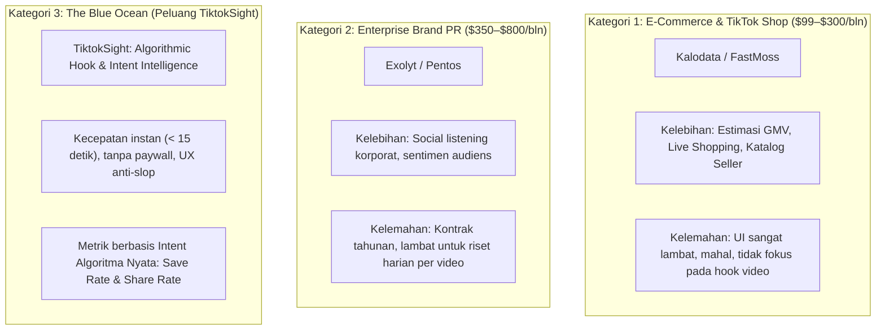
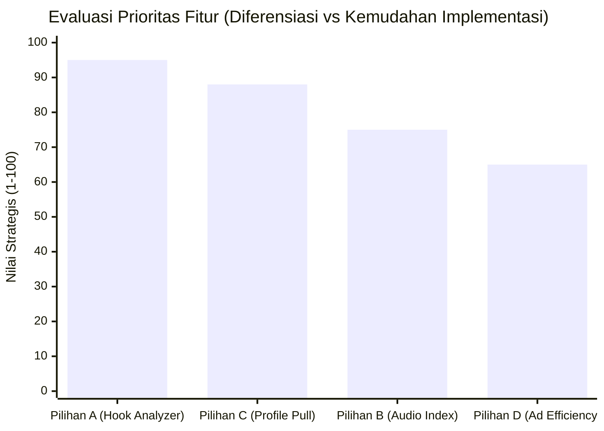

# Matriks Komparasi Produk: Kompetitor vs. TiktokSight

> [!NOTE]
> **Tujuan Dokumen:** Membantu founder menentukan fitur prioritas berikutnya dengan membandingkan lanskap pasar eksisting (**Kalodata, FastMoss, Exolyt, Pentos**) melawan keunggulan unik **TiktokSight**.

---

## 1. Peta Lanskap Kompetitif (*Market Positioning*)

---

## 2. Matriks Komparasi Fitur Utama

Berikut perbandingan fitur teknis antara platform enterprise dengan pendekatan terfokus TiktokSight:

| Fitur / Kemampuan | Kalodata / FastMoss | Exolyt / Pentos | Social Blade | TiktokSight (Saat Ini) | TiktokSight (Tahap Berikutnya) |
| :--- | :---: | :---: | :---: | :---: | :---: |
| **Harga Akses** | $89 – $300 / bln | $350 – $800 / bln | Gratis (Iklan) | **Gratis & Terbuka** | **Freemium Tier** |
| **Kecepatan Ingest** | 5–8 detik / halaman | Terjadwal berkala | Instan (Overview) | **Instan (< 10 detik)** | **Instant + Batch async** |
| **Batch Ingestion URL** | ❌ Tidak bisa link luar | ❌ Setup tracker dulu | ❌ Hanya profil | **✅ 10–50 video instan** | **✅ URL + Auto @username** |
| **Metrik Algoritma Intent** | ❌ Hanya angka mentah | ⚠️ Terbatas | ❌ Hanya total likes | **✅ Save Rate & Share Rate** | **✅ Virality Prediction Score** |
| **Intent Archetypes** | ❌ Tidak ada | ❌ Tidak ada | ❌ Tidak ada | **✅ 4 Tipe Algoritma** | **✅ Actionable Script Advice** |
| **Head-to-Head Video Battle** | ❌ Manual buka 2 tab | ❌ Tidak ada fitur A/B | ❌ Tidak ada | **✅ A/B Delta Radar** | **✅ Hook & Duration Contrast** |
| **Pemisah Iklan vs Organik** | ⚠️ Tab terpisah | ❌ Tercampur | ❌ Tidak ada | **✅ Deteksi otomatis `isAD`** | **✅ Ad Efficiency Multiplier** |
| **Ekspor Data Rapi** | CSV mentah rumit | PDF korporat formal | ❌ Tidak ada | **✅ Excel (.xlsx) ber-rumus** | **✅ Client Ready Audit Deck** |

---

## 3. Pembeda Strategis TiktokSight (*Our Unfair Advantage*)

1. **Anti-Slop & Frictionless Speed**: 
   Kompetitor menuntut sign-up, input kartu kredit, dan dashboard dengan puluhan tab lambat. TiktokSight beroperasi layaknya **Linear / Raycast**: buka URL, paste data, selesai dalam 10 detik.
2. **Intent Signals over Vanity Metrics**: 
   Algoritma TikTok For You Feed (FYP) tidak peduli follower; yang dinilai adalah **Save Rate (Evergreen Bookmark)** dan **Share Rate (Viral FYP Injection)**. TiktokSight adalah satu-satunya alat yang langsung menghitung rasio ini secara gamblang.
3. **Dedicated Hook Testing Workbench**: 
   Kreator dan agency butuh tahu *mengapa* Video A tembus 1M views sementara Video B hanya 10K. Fitur *Head-to-Head Battle* menyelesaikan kebutuhan ini secara langsung.

---

## 4. Empat Paket Fitur Pilihan (Silakan Dipilih)

Berikut rincian spesifikasi 4 paket fitur yang siap dibangun:

### 🎯 Pilihan A: Hook & Script Intelligence (Rekomendasi Utama #1)
> **Target Pengguna:** Content Creator, Scriptwriter, & Affiliate Marketer  
> **Tujuan:** Mengetahui formula kalimat pembuka (hook) yang paling ampuh memicu saves & shares sebelum mulai shooting.

- **Fitur 1: Hook Pattern Classifier**
  - Algoritma mendeteksi 3–5 kata pertama pada caption dan membaginya ke dalam formula:
    - *Format Angka:* Misal `"3 Cara..."`, `"5 Alasan..."`
    - *Format Pertanyaan:* Misal `"Kenapa kamu..."`, `"Pernah gak..."`
    - *Format Peringatan/Larangan:* Misal `"Jangan pernah..."`, `"Stop lakukan ini..."`
- **Fitur 2: Hook Conversion Leaderboard**
  - Menampilkan formula hook mana dalam batch yang menghasilkan **Save Rate** dan **Share Rate** tertinggi.
- **Fitur 3: Duration vs Retention Sweet Spot**
  - Korelasi durasi (15–30s vs 45–60s) terhadap engagement untuk menentukan batas durasi ideal topik tersebut.

---

### ⚡ Pilihan C: Profile Rapid Pull via @username (Rekomendasi Utama #2)
> **Target Pengguna:** Digital Agency, Brand Marketer, & Talent Scout  
> **Tujuan:** Menghemat waktu tanpa perlu copy-paste puluhan link video satu per satu.

- **Fitur 1: @username Ingestion Box**
  - Pengguna cukup memasukkan handle akun (contoh: `@aerostreet`, `@tokopedia`).
- **Fitur 2: Auto-Pull 12 Video Terakhir**
  - Sistem otomatis mengekstrak 12 video publik terbaru akun tersebut ke dalam data table secara instan.
- **Fitur 3: Profile Health Baseline**
  - Menghitung rata-rata engagement akun sebagai tolok ukur audit influencer sebelum bekerjasama.

---

### 🎵 Pilihan B: Audio / Sound Fatigue & Leverage Index
> **Target Pengguna:** Trend-Riders & Music Curators  
> **Tujuan:** Membedakan apakah video viral karena kualitas konten atau hanya terbawa gelombang audio tren.

- **Fitur 1: Sound Clustering**
  - Mengelompokkan video batch berdasarkan kesamaan `musicId`.
- **Fitur 2: Audio Fatigue Meter**
  - Menilai apakah suatu audio masih berada di fase kenaikan (*rising*) atau sudah jenuh (*saturated*).
- **Fitur 3: Sound Lift Score**
  - Menghitung seberapa besar audio mendongkrak performa video dibandingkan rata-rata akun pembuatnya.

---

### 💰 Pilihan D: Ad vs Organic Efficiency & ROAS Predictor
> **Target Pengguna:** Media Buyer & Brand Advertiser  
> **Tujuan:** Mengukur efektivitas video berbayar (*Spark Ads*) dibanding video organik murni.

- **Fitur 1: Paid Boost Penalty Matrix**
  - Mengukur apakah video iklan (`isAD = true`) berhasil menarik save/share organik atau hanya views kosong.
- **Fitur 2: Estimated Ad Efficiency Index**
  - Memberikan skor kualitas kreatif iklan kompetitor untuk bahan evaluasi tim *creative ads*.
- **Fitur 3: 1-Click Filter Split**
  - Tab terpisah untuk mengisolasi aset promosi vs aset edukasi organik.

---

## 5. Matriks Prioritas Keputusan

| Paket Fitur | Target User | Nilai Diferensiasi | Kemudahan Bangun | Rekomendasi PM |
| :--- | :--- | :---: | :---: | :---: |
| **Pilihan A: Hook Intelligence** | Creator & Copywriter | **95 / 100** | Mudah–Sedang | **Pilihan Terbaik #1** |
| **Pilihan C: Profile Pull (@user)** | Agency & Brand | **88 / 100** | Sedang | **Pilihan Terbaik #2** |
| **Pilihan B: Audio Leverage** | Trend Riders | **75 / 100** | Mudah | Alternatif Menarik |
| **Pilihan D: Ad Efficiency** | Media Buyer | **65 / 100** | Mudah | Pelengkap Lanjutan |

---

> [!TIP]
> **Saran Tindakan:**
> Jika fokus utama Anda adalah **memberi dampak langsung bagi kreator konten & scriptwriter**, pilih **Pilihan A**.  
> Jika fokus utama Anda adalah **mempermudah riset agency & audit kompetitor masif**, pilih **Pilihan C**.
